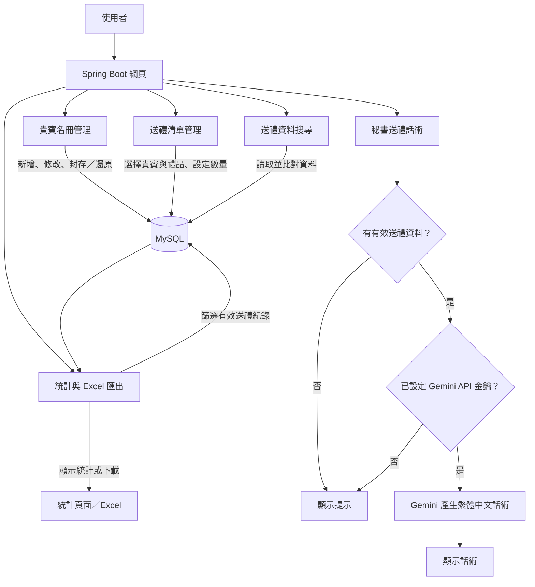

# 貴賓送禮管理系統流程圖

這個專案以 Spring Boot 提供網頁介面，管理貴賓名冊與送禮紀錄；資料主要儲存在 MySQL。

## 簡要說明

- **貴賓名冊**：新增或修改聯絡、職稱與配送資料，也可將貴賓移入冷宮名單或還原。
- **送禮清單**：為貴賓選擇禮品與數量並儲存；已選取的有效紀錄會納入統計。
- **搜尋與統計**：搜尋貴賓或禮品；統計可依關鍵字、品項與配送方式篩選，並匯出 Excel。
- **秘書話術**：有有效送禮明細且已設定 Gemini 金鑰時，才會呼叫 AI 產生簡短話術。

> 搜尋目前直接查詢 MySQL 資料；專案雖有 Elasticsearch 相依套件，這段流程沒有使用它。
